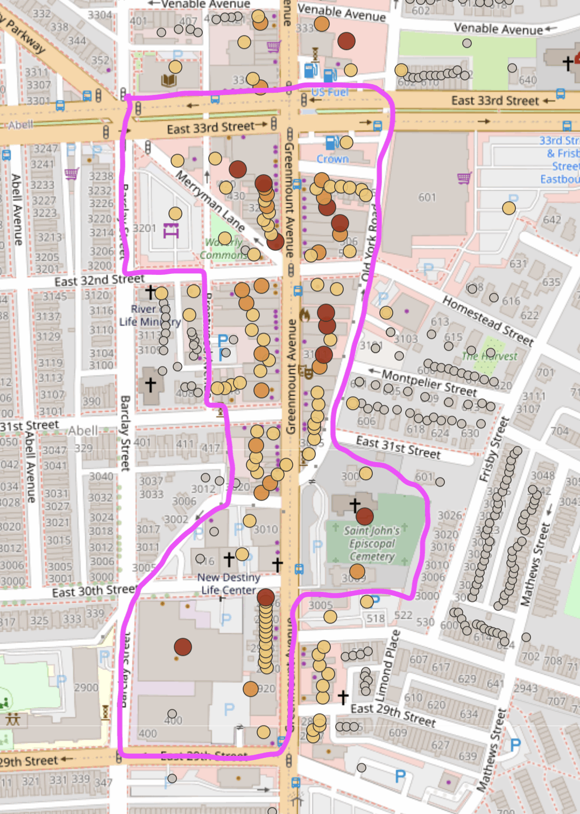

# Pricing the Unpriced — Sample Data Package
**NYU CUSP Capstone 2026–2027 · Sponsor: BNBD / Oxcart Assembly**

This repository is the sponsor data package for the NYU CUSP 2026-2027 Capstone project
*Pricing the Unpriced*. It is an export of the sponsor's Greenmount corridor knowledge base,
plus the public source files, so a student team can judge data readiness before committing.

**Study area: Greenmount Ave and one block either side.** The export holds the 699 properties
on Greenmount Ave (Baltimore, ZIP 21218) or within 150 m of it, about one block, and every row in
the other tables that belongs to them, including 7,891 hand-researched records. This is the
October 2026 refresh; see "What changed in the October 2026 refresh" below. The sponsor's full
database also holds Baltimore Peninsula parcels and outlying residential streets (Guilford Ave, Homestead St, and others); those were left out to
keep the package focused. See "How the study area was cut" in §4.
Everything here is sponsor-produced or public record. No personal user data is included: property
owner names are retained because they are SDAT public record and are the substance of ownership
research, but every phone number in the incident table's `summary` and `data` was replaced with
`[phone redacted]` before publication: 24 numbers in 21 rows, most from the liquor-license feed
and newspaper items. They carried no analytical value. `storefront_assessments.csv` keeps the
business phone numbers it quotes from public listings (Google, shop signs), in 39 rows.

---

## QUICKSTART

You need Python 3.10+ and [uv](https://docs.astral.sh/uv/getting-started/installation/)
(`brew install uv` on macOS, or `pipx install uv`, or `curl -LsSf https://astral.sh/uv/install.sh | sh` on Linux).

```bash
git clone https://github.com/jetton999/pricing-the-unpriced.git
cd pricing-the-unpriced
uv sync                                   # creates .venv with every dependency
uv run pre-commit install                 # keeps notebook outputs out of git
uv run jupyter lab START_HERE.ipynb       # opens the starter notebook
```

Run the notebook top to bottom (Run > Run All Cells). It takes under a minute and walks through:

| § | What it shows |
|---|---|
| 0 | Columns in `properties.csv` that are blank or all-zero, and so are not data |
| 1 | The curated archival layer vs the administrative feeds (read §1 below first) |
| 2 | Evidence grading, sensitivity flags, and claim-to-claim links |
| 3 | Where documentation depth is concentrated, and when (the decade chart) |
| 4 | **Idea 1:** one property's use history, which properties have one, block sides as the assemblage unit, and what is on each ground floor today |
| 5 | **Idea 2:** what corridor commercial buildings cost, the July 2026 baseline (joined through the id crosswalk), and a toy lease-to-own calculator |
| 6 | A one-row-per-property starter table for both ideas |

Two more things work with no install beyond Python itself:

```bash
python3 map/app.py            # map of every property; open http://localhost:8765
python3 verify_claims.py      # checks every number in these docs against the CSVs
```

<details>
<summary>No uv? Use pip in a virtual environment instead.</summary>

```bash
python3 -m venv .venv
source .venv/bin/activate                 # Windows: .venv\Scripts\activate
pip install pandas matplotlib jupyterlab jupytext nbstripout pre-commit
pre-commit install
jupyter lab START_HERE.ipynb
```

A bare `pip install` outside a virtual environment fails on recent macOS (Homebrew) and
Debian/Ubuntu Python with `externally-managed-environment`. That is why the venv step is there.
</details>

**Editing the notebook.** `START_HERE.py` and `START_HERE.ipynb` are the same notebook, paired
with [jupytext](https://jupytext.readthedocs.io/). The `.py` is the source of truth: edit it, then
run `uv run jupytext --sync START_HERE.py`. Once `pre-commit install` has run, the sync and the
output stripping happen automatically on every commit. Working with a coding agent? Point it at
[`AGENTS.md`](AGENTS.md) and have it run `bin/check` before it says it is done. `bin/check` is a
bash script: on Windows, run it from WSL or Git Bash, or run `python3 verify_claims.py` and
`python3 map/app.py --check` directly. Without uv, activate your `.venv` first.

### What's where

| Path | What it is |
|---|---|
| `START_HERE.ipynb` / `.py` | The starter notebook. Start here. |
| `PROJECT_IDEAS.md` | The two applied project ideas, in full. |
| `DATA_DICTIONARY.md` | Every column of every table, with the empty ones marked. |
| `*.csv` | The sixteen exported tables (§4). |
| `map/` | Standard-library map app over the CSVs. See `map/README.md`. |
| `docs/` | Background research: worker- and tenant-owned exit cases; the coding-agent setup plan. |
| `site/` | The revised proposal (September 2026) as a single HTML page, plus its PDF. |
| `public_sources/` | Third-party files: National Register, federal DOEs, HOLC polygons (§5). |
| `Pricing_the_Unpriced_CUSP_Proposal.pdf` | The original July 2026 proposal (§7). |
| `verify_claims.py` | Checks every number in this README, and where the other docs repeat it. Standard library only. |
| `bin/check` | Runs all the checks: doc claims, map data, `.py`/`.ipynb` pairing, notebook execution. |
| `bin/cut_study_area.py` | Reproduces the study-area cut from the full export in git history (§4). Standard library only. |
| `bin/export_matterport_tours.rb` | How `matterport_tours.csv` was made from Corridor. Sponsor-side; you do not run it (§4d). |
| `bin/fetch_archive_scans.py` | Rewrites the two City Archives tables from the sponsor's public viewer (§4c). Standard library only. |
| `bin/fetch_images.py` | Downloads the images listed in `property_images.csv` into `images/` (§4e). Standard library only. |
| `images_base_url.txt` | Where those scans are hosted. `image_key` is appended to it. |
| `bin/clean_addresses.py` | Standardizes addresses and merges the eight duplicate properties; run after the cut (§4). Standard library only. |
| `05_incidents_by_decade.png` | The corpus at a glance (§1). |
| `proposed-focus-area-phase1.png` | The proposed first focus area for Idea 1, shown in `PROJECT_IDEAS.md`. |
| `row_counts.txt` | Export row counts. |

---

## What changed in the October 2026 refresh

The CSVs were regenerated from the sponsor's Corridor database in October 2026. The study-area
rule is unchanged (`bin/cut_study_area.py`, 150 m, then `bin/clean_addresses.py`). Outside this
section, every number in these docs is the October number, and `verify_claims.py` checks it.

- **More properties: 665 → 699.** New parcels entered Corridor after September.
- **The curated layer more than doubled: 3,597 → 7,891 rows** (all incidents: 10,576 → 17,387).
  Most of the growth is MDLandRec land records (492 → 1,691), Newspapers.com items (661 → 1,658),
  City Archives tax rolls (`bca_tax_rolls`, 608, new) and DHCD files (`bca_dhcd`, 17 → 696),
  Polk directories (63 → 201), and local news (`local_news`, 181, new). Also new: PI.KL Studio's
  2026 conditions-survey findings for the Maryland Historical Trust (17 `field_report` rows), crime
  reporting that names defendants, and Passano-O'Neill file cards (`passano_oneill`).
- **Sensitivity flags: 52 → 126.** All 52 of the September flagged rows are still here.
- **What is held back.** The sponsor's own deal documents, financing (contracts of sale, closing
  files, its deeds of trust) and internal deal notes are not in the package. Recorded deeds are
  public record and ship, the sponsor's included. Of the sponsor's own field notes, only a few
  street-level observations ship: the 2625–2627 Greenmount fire and demolition and the 2607–2609
  condemnation notice (5 `field_report` rows, beside the 17 PI.KL survey findings). Some rows ship
  with part of their text taken out, and every phone number in the incident table is redacted (see
  the top of this README).
- **37 September incident rows are gone.** 6 were duplicate 311 rows merged by
  `bin/clean_addresses.py`. The other 31 are curated rows (16 white-paper, 9 Sanborn,
  5 MDLandRec, 1 field report) that Corridor deleted as corrections or that are withheld under the
  rule above.
- **52 September property ids no longer exist.** Corridor merged parcels that one building had
  absorbed (for example, 2803 to 2851 Greenmount Ave into 2801, id 688). `property_id_crosswalk.csv`
  maps every one of them to the surviving parcel (`old_id` → `new_id`). The surviving parcel lists
  what it absorbed in the new `absorbed_addresses` column.
- **`baseline_snapshots.csv` is frozen at t0** and unchanged byte for byte, so it still uses the
  September ids. Join it through the crosswalk (§4b).
- **`grant_program_matches.csv` is carried forward from September.** None of its rows was on a
  retired id.
- **New columns on `properties.csv`:** `tax_sale_years`, `city_since_years`, `vacant_lot`,
  `absorbed_addresses` (§4).
- **New tables:** `storefront_assessments.csv` (§4f), `property_images.csv` (§4e), and
  `property_id_crosswalk.csv`.
- **`fair_market_rent_2br` is now 2006** (was 1857). It is still one area-wide value in every row.
- **Administrative fields changed** because Corridor re-fetched them: owner names, last sale
  prices, assessments, and the like. That is expected.

---

## Two applied project ideas (September 2026)

Since the July proposal, the sponsor has sketched two applied projects that run on this same
record. Both are described in **[PROJECT_IDEAS.md](PROJECT_IDEAS.md)**, and a revised proposal
presenting them is in **[`site/`](site/)**.

1. **Heritage-anchored highest and best use.** Given an assemblage of buildings, what should each
   one become, what would it earn, and does the mix work as a block? It starts from what each
   address *was*. The use-history timeline it needs is exactly what the provenance layer in this
   package produces. The proposed first focus area is E 33rd St south to E 29th St, between
   Barclay St and Old York Rd:

   

2. **From tenant to owner.** A lease that starts a business as an ordinary tenant of the sponsor's
   real estate trust and ends with it owning the building. It is designed against eleven documented
   worker- and tenant-ownership cases in Baltimore, DC, New York, and Portland
   (`docs/worker-owned-exits.md`).

A team may take one idea or both. The data package below, its layer distinction, and its warnings
carry over unchanged.

---

## 1. Read this before you look at the row counts

The incident table has **17,387 rows, and that number is misleading on its own.**

| Layer | Rows | What it is |
|---|---|---|
| **Administrative feeds** | ~9,500 | Machine-ingested: 311 complaints (5,158), permits (1,642), SDAT assessments (853), crime (822), tax-sale history, tax certificates, code violations. Overwhelmingly 2020s. |
| **Curated historical records** | ~7,800 | Hand-researched across 40+ archival sources: MDLandRec deeds (1,691), Newspapers.com (1,658), research white papers (1,126), City Archives DHCD files (696) and tax rolls (608), church interment rolls (583), Sanborn fire-insurance maps (284), Polk directories (201), NRHP nominations (158), local news (181), Hopkins atlases, Chronicling America, census records. |

The rule: a `source` is administrative if it starts with `baltimore:` or is `sdat_assessments`
or `sdat:owner`. Everything else is curated. The notebook, the map, and `verify_claims.py` all
use this one rule.

**7,086 incidents predate 2000. 4,699 predate 1950.** The earliest dated record is 1658, the
Stansbury land assignment that underlies the 1688 Huntington and Merryman's Lot patent; the first
recorded residence on the tract is 1736.

Separating these two layers is not a preprocessing chore. **It is the research problem.**
An index that rewards whichever property generated the most paperwork has learned nothing
about historical significance. The proposal names this the archival-abundance risk and
commits to a source-coverage measure; this package is where you will first see why.

See `05_incidents_by_decade.png` for the picture: one panel per layer, each on its own scale.

## 2. Documentation depth is concentrated

| Curated incidents | Properties |
|---|---|
| ≥ 1 | 441 |
| ≥ 10 | 160 |
| ≥ 25 | 61 |

(These are what section 3 of the notebook prints. The deepest three are 2376 with 603
curated incidents, then 2332 and 726 with 293 each.)

The deep end is the labeled spine the index gets built and validated on. The rest of the
699 properties carry mostly administrative traces. Sparse documentation is **not**
evidence of no history; treat it as unmeasured.

## 3. Evidence grading is real but partial

Every incident is a *claim*, not a fact. The schema carries `evidence_status`
(verified / probable / possible / contested / refuted), `date_precision` (exact / year / range /
circa / decade / unknown), `sensitivity`, and `rights`.

Coverage today: **5,538 incidents graded** (4,757 verified, 611 probable, 152 possible,
10 contested, 8 refuted) and **6,342 with explicit date precision**. Those totals span both layers:
4,993 of the graded rows are curated, and 545 are administrative (mostly `sdat:owner` ownership
records, all 454 marked verified). Of the 7,891 curated rows, 2,898 are still ungraded. Back-filling
and validating this grading is committed capstone work.

`incident_links.csv` already encodes disagreement between claims: 1,053 `related`,
769 `supports`, 25 `duplicates`, 21 `contradicts`.

## 4. Tables

| File | Rows | What it is |
|---|---|---|
| `properties.csv` | 699 | Properties in the study area with ~80 enrichment fields: assessment, sale history, vacancy, zoning, market, transit, HMDA, program-eligibility flags. 668 have coordinates; 59 block sides. 668 have a `last_sale_price`, but 140 of those are $0 transfers, so 528 carry a real price. |
| `property_incidents.csv` | 17,387 | The claim layer. See §1 before using. |
| `subjects.csv` | 3,093 | Graph nodes: 2,037 people, 517 businesses, 298 organizations, 138 families, plus places, teams, congregations. |
| `incident_subjects.csv` | 5,451 | Subject↔incident edges: `owned` (923), `operated_at` (675, of which 413 name a business), `sold` (659), `interred_at` (596), `purchased` (452), `lived_at` (280), and more. Joined through incidents, subjects and properties form a graph of 3,562 nodes and 3,733 edges. |
| `incident_links.csv` | 1,868 | Incident↔incident edges, including contradictions. |
| `registered_ips.csv` | 37 | 23 trademarks and 3 entity registrations with an address of record in the study area, plus 11 historical patents tied to the corridor by people rather than address (the Ouija board, whose inventor is buried at Green Mount Cemetery, and 10 unconfirmed surname leads to corridor families). 16 are matched to a specific property. |
| `property_parcels.csv` | 850 | City parcel roll for the study area's blocks: address, blocklot, owner, land use, sqft. The linkage layer. |
| `grant_program_matches.csv` | 5,319 | Property↔program matches behind the live "Improve Your Property" tool. Carried forward from September. |
| `neighborhoods.csv` | 5 | Neighborhood names only. The `bounds` column is empty in this export. |
| `baseline_snapshots.csv` | 883 | **The t0 line.** Frozen, on September ids. See §4b. |
| `archive_folders.csv` | 31 | The Baltimore City Archives' 31 DHCD Waverly folders (BRG48-43-10): 1970s and 1980s planning papers. See §4c. |
| `archive_scans.csv` | 2,260 | One row per scanned page filed on a building: 1,692 distinct pages, 142 buildings, 1877 to 1988. A one-line caption, the date the page depicts, and links to the image. See §4c. |
| `matterport_tours.csv` | 13 | Public Matterport 3D walkthroughs of the sponsor's buildings, one row per tour. See §4d. |
| `property_images.csv` | 3,694 | Images filed on properties: scans of deeds, liens, permit cards, 1896–1915 tax ledgers, 1915 Sanborn sheets, Passano-O'Neill file cards, and PI.KL Studio's 2026 building-conditions survey photos. 3,090 image files on 348 properties. The images download separately. See §4e. |
| `storefront_assessments.csv` | 264 | What occupies each ground floor in 2026, one row per property, with its evidence. See §4f. |
| `property_id_crosswalk.csv` | 52 | September property ids retired in October, each mapped to the parcel that absorbed it. |

Notes: `data` columns are JSON payloads. Respect `sensitivity` and `rights` on incidents —
some claims are flagged restricted or consent-dependent.

**How the study area was cut.** A property is in the export if its address is on Greenmount Ave,
or it lies within 150 m (about one block) of a Greenmount Ave property. Properties without
coordinates take the distance of a same-street neighbour within ten house numbers, and the
"Old Waverly Village — York Road" record is kept by hand (York Road is Greenmount's historic
name). Every other table follows its properties: incidents by `property_id`; subjects, subject
links, and incident links through those incidents; parcels and unmatched registered IP by street
and hundred-block. The 11 patents have only a city-level address and are kept whole. In September the cut dropped 5 curated records and no rows with a `sensitivity` flag. The
full September pre-cut export is in this repository's git history (commit `e00b32b`), and
`bin/cut_study_area.py` reproduces the September cut from it (usage at the top of the script).
The October 2026 refresh applied the same rule to a new Corridor export.

**Addresses and merged duplicates.** The cut is followed by `bin/clean_addresses.py`, and the two together
reproduced the September CSVs byte for byte. An import on 2026-04-06 had added about 140 properties with
City-style addresses (`608 E 30TH ST, Baltimore, MD 21218`), and eight of them duplicated a property that was already
there. Every address is now in one format: mixed case, no ZIP, ending `, Baltimore, MD` (`608 E 30th St, Baltimore, MD`).
The five named places with no house number are left as they were. The eight duplicate pairs share an SDAT
account (`blocklot`), so each is one parcel; the copy that was already in this format stays, takes the other copy's
`block_side_id`, and receives its incidents, parcels, and matches. The merge dropped 38 repeated administrative
incidents (same `source` and `source_id`) and 63 repeated program matches (same `program_key`), and no curated
incident and no row with a `sensitivity` flag. The 673-property version is in git history (commit `3208af0`).

**Columns that look like data but are not.** Some `properties.csv` columns are blank in every
row (`avm_estimate`, `flood_zone`, `walk_score`, `transit_score`, `bike_score`, `building_condition`,
`building_quality`, `num_stories`, `irs_agi_per_return`, `irs_homeowner_pct`). Others hold the
same value in every row, so they cannot tell one property from another:

- `0` or `False` everywhere, which is a placeholder, not a measurement: `sale_count`,
  `nearby_restaurants`, `nearby_shops`, `nearby_amenities_total`, `public_investment_total`,
  `has_basement`, `has_central_ac`, and the flags `opportunity_zone`, `inspire_eligible`,
  `arts_district`, `lincs_corridor`, `hud_reo`, `difficult_development_area`.
- Area-wide figures, identical across the study area: `zip_code` (21218),
  `fair_market_rent_2br` (2006), `market_median_sale_price`, `market_median_dom`, `market_inventory`.
- `city_since_years`, new in October, is `{}`, an empty list, in every row.

`DATA_DICTIONARY.md` marks them all, and section 0 of the notebook finds them programmatically.
Drop them before building features.

**Columns added in October 2026.** Four new columns on `properties.csv`:

- `tax_sale_years`: the years the property went to a City tax sale, as a Postgres array
  (`{2021,2024}`). 155 properties have at least one year; the rest are `{}`. The
  `baltimore:tax_sale_history` incidents carry the detail (redeemed or not, and when).
- `city_since_years`: empty (`{}`) in every row.
- `vacant_lot`: `true` for 58 properties, `false` for the rest. It is Corridor's parcel flag, not
  the storefront assessment: 13 properties the assessment calls `vacant_lot` are `false` here.
- `absorbed_addresses`: a JSON array of the addresses a parcel absorbed when Corridor merged
  them. 79 properties absorbed 184 addresses; the rest are `[]`.

## 4b. The t0 baseline — the "before" line already exists

`baseline_snapshots.csv` is the most time-sensitive asset in this package, because a
before/after design cannot recreate its own starting line retroactively.

Two capture days are on record: **2026-07-13 (349 properties)** and **2026-07-22 (534 properties)**.
Each row freezes one property as of that date across 28 fields: `assessed_value`, `avm_estimate`,
`last_sale_price` / `last_sale_date`, `sale_count`, `vacancy_indicator`, `vacant_notice_status`,
`active_permit_count`, `violations_12mo_count`, `building_condition`, `dwelling_units`,
`has_active_business`, `owner_name` / `owner_type`, `ground_rent`, `city_owned`,
`receivership_status`, `tax_certificate_active`, `hmda_loan_count` / `hmda_denial_rate` /
`hmda_median_value`, `cdbg_investment_total`, `public_investment_total`, `market_typology`,
`market_median_sale_price`, `fair_market_rent_2br` —
**and, critically, `incident_count` and `registered_ip_count`, the provenance depth at that moment.**
Seven of the 28 were captured empty: `avm_estimate`, `building_condition`, `market_median_sale_price`,
and `vacant_notice_status` are blank; `ground_rent` is blank or 0; `sale_count` and
`public_investment_total` are 0.

That last pair is what makes this a research instrument rather than a property dump. It records how
much was *known* about each property on a fixed date, so later documentation work becomes a
measurable treatment rather than an untracked confound. Capture continues on the sponsor's side.

**Join the baseline through the crosswalk.** The file is frozen at t0 and keeps the September
property ids. 104 of its 883 rows are on an id the October refresh retired: map `property_id` through
`property_id_crosswalk.csv` (`old_id` → `new_id`) before joining to `properties.csv`. After that every
row joins. Notebook §5b shows the join.

## 4c. The City Archives scans (added October 2026)

The Baltimore City Archives holds the city's own Waverly files from the 1970s and 1980s: 31 DHCD
folders (record group BRG48-43-10) of urban renewal planning, parking lots, facade work, design
standards, consultants, and meeting papers. The sponsor scanned them one image per page and filed
each page on the building it concerns; a page about several buildings is filed on each.
`archive_scans.csv` lists every scan the public City Archives viewer shows: 2,260 scans, 1,692
distinct pages, 142 buildings, with a one-line caption, the date the page depicts, and links to the
image. `archive_folders.csv` is the folder index.

- **Count pages, not scans.** A page filed on three buildings is three rows. Use `item` and `page`
  to count distinct pages.
- **Captions are not transcriptions.** Each is one line, written by a vision model or by hand. Open
  the scan (`scan_url`) before you rely on one.
- **Every building joins.** All 142 buildings are in `properties.csv`. (In September, 345 and
  347 E 33rd St were newer than the export; the October refresh includes them.)
- **The scans themselves are not in this repository,** only links to them. They are public records
  of the City of Baltimore, served by the viewer at
  https://greenmountcorridor.com/properties/gallery?gal_source=archives. `bin/fetch_archive_scans.py`
  rewrites both tables from that page, with no login.

## 4d. The Matterport tours (added October 2026)

The sponsor has scanned the interiors of many corridor buildings with Matterport. `matterport_tours.csv`
lists the public, active tours: 13 tours of 12 buildings, scanned April to August 2026. Open
`share_url` to walk the building in a browser. Seven of the twelve buildings are inside the proposed
focus area: 3011, 3015, 3026, 3107, 3117, 3200, and 3224 Greenmount Ave.

- **One tour per building is primary** (`is_primary`); 3313 also has an auxiliary-room tour.
- **The tour for 3026 is titled "3028" inside Matterport.** It is 3026; `label` says so.
- **Private and archived tours are not listed.** More buildings are scanned than appear here.
- **The scans are hosted by Matterport,** not in this repository, and are the sponsor's work. Ask
  before reusing the images. `bin/export_matterport_tours.rb` shows how the table was made.

## 4e. The property images (added October 2026)

`property_images.csv` lists images the sponsor has filed on corridor properties: scans of records,
and 2026 survey photos. 3,694 rows, 3,090 image files, 348 properties. Five folders:

| `folder` | Rows | Files | What it is |
|---|---|---|---|
| `deeds-and-title-chain` | 1,054 | 925 | Recorded deeds, mortgages, leases, liens, and City building-permit cards. |
| `bca-brg4-1` | 655 | 228 | City tax ledgers and annual assessment rolls, 1896 to 1915 (Baltimore City Archives). |
| `loc-sanborn` | 4 | 2 | 1915 Sanborn fire-insurance sheets. |
| `passano-oneill` | 104 | 104 | Passano-O'Neill file cards on Greenmount Ave buildings, 1802 to 1938 (Maryland Center for History and Culture). Reproduction cleared. |
| `pikl-greenmount` | 1,877 | 1,831 | PI.KL Studio's 2026 building-conditions survey photos for the Maryland Historical Trust's Waverly Main Street survey: roofs, facades, commercial interiors. The same survey as the 17 PI.KL `field_report` incidents. 14 buildings. 1,873 photos, plus three report pages and field notes and one scanned 1958 newspaper ad. |

- **Count files, not rows.** One image filed on several properties, or listed twice under two ids,
  is one file and several rows. Count distinct `image_key`.
- **Captions describe an image; they are not transcriptions.** Open the image before you cite it.
  `depicted_on` is the date the record depicts, read with `depicted_precision`. The record scans
  depict 1742 to 2023; 164 of them have no date. The survey photos are undated (they were taken in
  2026) and carry a `subject` instead: `interior` (873), `detail` (415), `roof` (368), `exterior`
  (111), `streetscape` (61), `alley` (39).
- **The survey photos were reviewed before publication.** 68 were held back: recognizable people,
  signs of people sheltering, security panels, and images too small to judge.
- **The images are not in git.** `image_key` (`img/<sha256>.jpg`) is appended to the URL in
  `images_base_url.txt` (https://pricing-the-unpriced.greenmountcorridor.com). `python3 bin/fetch_images.py`
  downloads them into `images/`, which is gitignored. Run `python3 bin/fetch_images.py --dry-run`
  for the size before you download; narrow it with `--folder` or `--property`. Every file is a
  re-encoded JPEG with its metadata stripped.
- **Send a `User-Agent` header if you fetch the URLs yourself.** The host answers a request without
  one (bare Python `urllib`, for example) with `403 Forbidden`. `bin/fetch_images.py` already sends
  one; with `requests` or `curl` you are covered by their defaults.
- **The City Archives DHCD scans are not here.** They stay in `archive_scans.csv`, as links (§4c).

## 4f. The storefront assessments (added October 2026)

`storefront_assessments.csv` is the sponsor's street-level assessment of what occupies each ground
floor in 2026: 264 properties, one row each, all assessed on 2026-10-07.

| `status` | Rows |
|---|---|
| `open_active` | 87 |
| `residential` | 56 |
| `vacant_storefront` | 49 |
| `vacant_lot` | 39 |
| `institution` | 19 |
| `office_industrial` | 11 |
| `listed_likely_dead` | 2 |
| `needs_eyes` | 1 |

`confidence` is `high` (142), `medium` (117), or `low` (5). `summary` says why in a few sentences.
`evidence` is a JSON array of 1,428 findings in all, each with a `source` (Google, Street View
photos, zoning, City vacancy data, listings, news, and others), an `as_of` date, the `finding`,
and usually a `url`. Findings quote business phone numbers from public listings and shop signs
as they appear. `observed_on` is blank in every row. This is a 2026 present-state layer: it
tells you what is there now, not what the building was.

## 5. Public sources (`/public_sources`)

- `national-register-listed_20260522.xlsx` — NPS National Register, 100,867 dated listings. Treatment data for the conditional external analysis.
- `federal-DOEs_20260522.xlsx` — Federal Determinations of Eligibility. Included so you can verify the proposal's finding that it is **unsuitable** as a control: rows are federal projects, undated.
- `holc_baltimore_1937.geojson` — HOLC "redlining" polygons (Mapping Inequality, Univ. of Richmond).

Fetch directly, not redistributed here: Open Baltimore (parcels, permits, vacancy),
Maryland SDAT, NPS IRMA GIS (Ref. 2210280), ACS/TIGER. ZTRAX is restricted-use via ICPSR
and cannot be redistributed; the committed corridor work does not depend on it.

## 6. Known limitations, stated up front

- **Coverage is uneven by design.** Research followed interest and grant funding, not a sampling frame. Expect selection effects in which properties are deeply documented.
- **Evidence grading is incomplete** (see §3).
- **Some columns are empty or zero-filled** (see §4). A `0` in `nearby_restaurants` or `sale_count` means "not captured", not "none".
- **Sale prices include portfolio deals.** When several parcels sell together, each parcel carries the whole deal price. Drop any price and date shared by more than one parcel before computing price per building or per sqft (notebook §5a). One portfolio deal cannot be caught this way: 701 Exeter Hall Ave (R-6, $19,000,000 on 2026-03-19) shares its price and date with a parcel outside the study area, so in this export it looks like a single sale. Drop it too.
- **Geocoding and parcel matching are imperfect.** `property_parcels.matched_property_id` is null for most rows.
- **Temporal leakage is the sharpest methodological trap.** A white paper written in 2026 cannot inform a 2005 sale price. Reconstruct what was knowable *as of* the outcome date.
- **`assessed_value` is an administrative outcome, not a market price.** Do not present it as one.
- **Only two baseline days exist so far.** Treat t0 as a fixed reference point, not a time series.

## 7. About the proposal PDF

`Pricing_the_Unpriced_CUSP_Proposal.pdf` is the full July 2026 proposal: methods, tiered scope,
work plan, risk register. It was written before the CSVs here were exported, so the corpus grew
underneath it. Where the proposal says "~354 documented properties, ~2,600 documented incidents,"
this export holds 699 properties and 17,387 incidents (7,891 of them curated). The proposal's
"~150 registered intellectual-property records" counted the whole knowledge base; the study area
holds 37. The CSVs are authoritative.

`verify_claims.py` checks every number in this README against the CSVs, along with the copies of
those numbers in `AGENTS.md`, `DATA_DICTIONARY.md`, `PROJECT_IDEAS.md`, `LICENSE.md`, `START_HERE.py`, `map/`,
and `site/`. It is standard library
only: run `python3 verify_claims.py`. If it ever disagrees with this README, the data wins and the
README is what needs fixing.

Live tools the pilot extends: **greenmountcorridor.com/research** · **greenmountcorridor.com/improve**

---

## 8. License

Sponsor-produced data is CC BY 4.0. Third-party files in `/public_sources` carry their own
terms, and the HOLC polygons are CC BY-NC-SA 4.0. See [LICENSE.md](LICENSE.md), which also
explains why 126 incident rows carry a `sensitivity` flag and why you should not silently
drop them.

## 9. Questions

Open an issue on this repository, or contact the sponsor directly. For a search on a source behind the sponsor's accounts (Newspapers.com, MyHeritage, Maryland Land Records), open a **Lookup request** issue; the sponsor's research desk runs them nightly. See `docs/research-desk.md`. The sponsor maintains the
production system this pilot extends, so you will not be the IT department.
